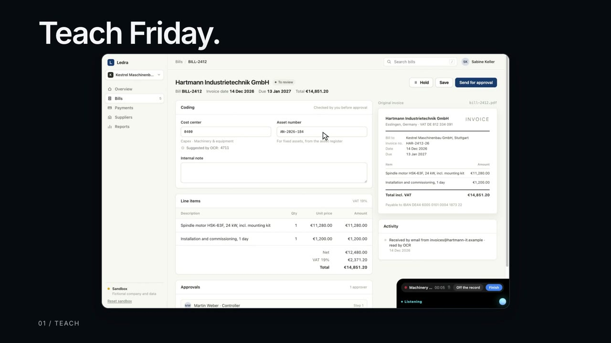
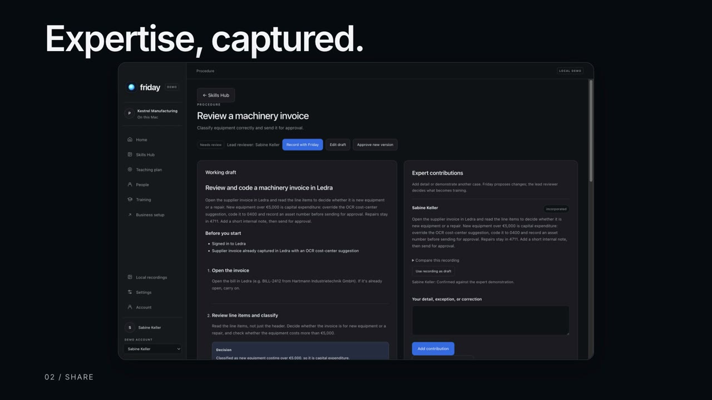
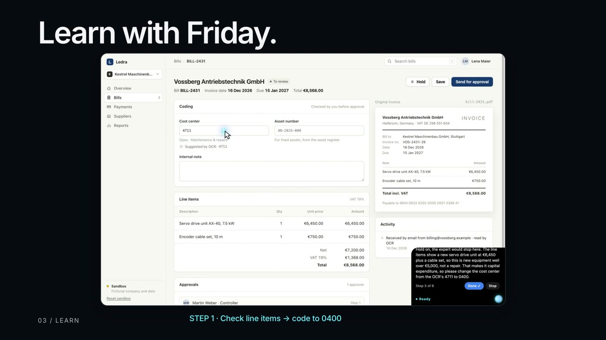
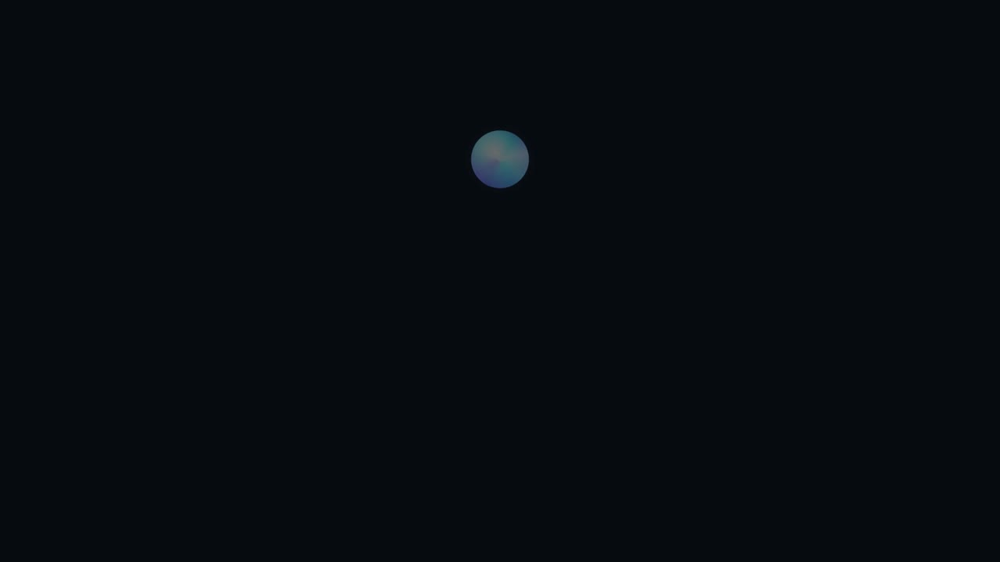

# Friday

An AI training companion for the Mac. An expert shows Friday how a task is done, and Friday teaches it to everyone else on the team.

**[Watch the 78-second demo](https://shyaamdylan.github.io/friday/)**

> The source code is private. This page describes the project.

## The idea

In most teams, one person knows how a process really works: which box to tick, which rule applies, when to stop and ask. Everyone else learns it by interrupting that person. Friday sits in the corner of the screen as a small glowing orb and carries that knowledge from the expert to the rest of the team.

## How it works

### 1. Teach

The expert says "Hey Friday, here's how to code a machinery invoice" and does the task as normal, explaining the rules out loud. Friday watches the clicks and listens to the reasons.

### 2. Share

Friday turns what it saw into a skill: the steps, the reason for each one, and the points where the expert said to stop and check. Skills live in a hub the whole team can open.

### 3. Learn

A new team member asks Friday to walk them through it. Friday points at each button in turn and explains why. If they make a wrong call, it stops them: code a €7,200 piece of equipment as a running cost and Friday says the expert would put that under capital expenditure.

### 4. Spot

Once someone is confident, they can say "Friday, spot me" and do the task alone. Friday stays quiet and only speaks up when something needs a second look.

## Jarvis

The same orb has a second mode. Say "Hey Jarvis" and it turns gold and does a task Friday has learned, clicking through it for you. It asks for the details that change from case to case, tells you what it is about to do, and waits for a yes. It can also find and open files, switch windows and press buttons by name.

Jarvis is careful by design:

- It only carries out tasks it was taught.
- Nothing happens until you say yes, and anything hard to undo (send, delete, pay, submit) needs its own yes every time.
- It never types passwords or card numbers.
- You can stop it at any moment with Esc, by saying "stop", or by clicking anywhere.

## How it was built

A Mac desktop app built with Electron. It reads the real buttons on screen through macOS Accessibility, so it knows exactly where each one is, and sends a screenshot to Claude to understand what is happening. Voices and the "Hey Friday" wake word use ElevenLabs. I built it with AI coding tools.

The invoicing app in the demo is made up for the video.
